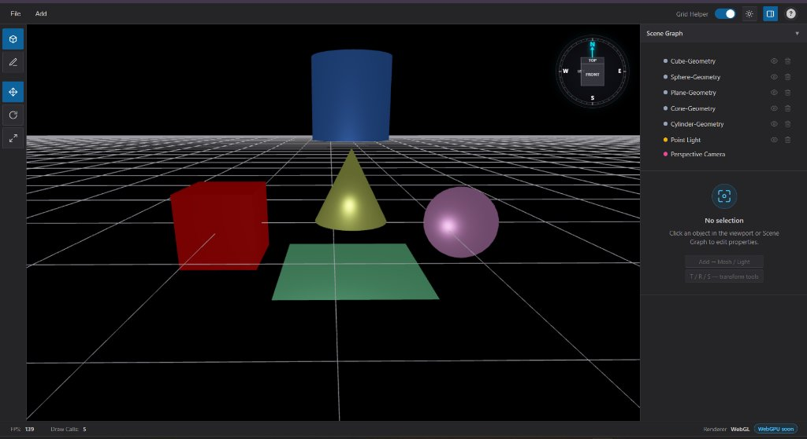
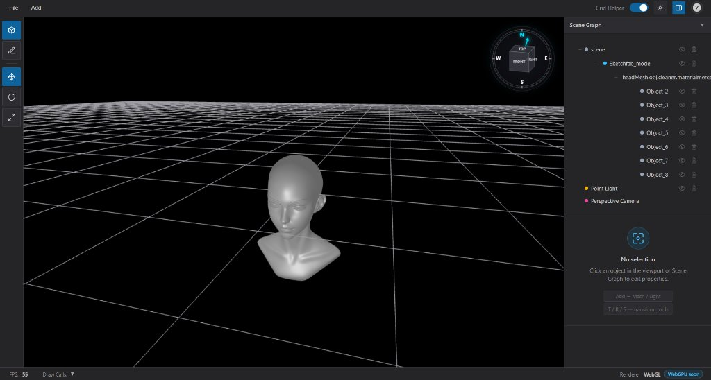
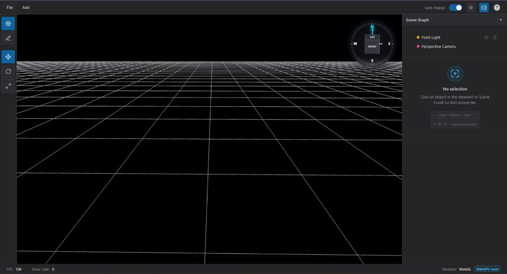
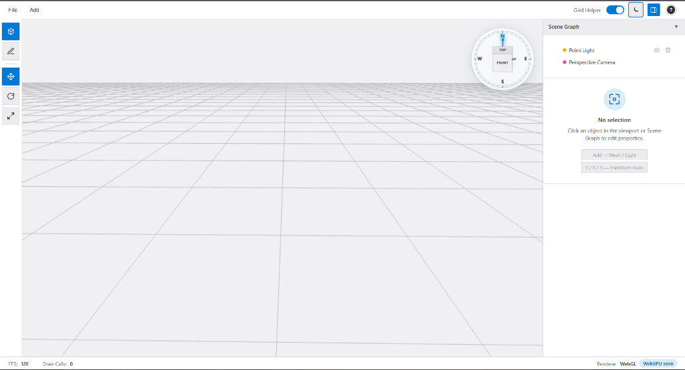

# Vara3D Graphics Engine

[](https://www.typescriptlang.org/)
[](https://developer.mozilla.org/en-US/docs/Web/API/WebGL_API)
[](https://www.khronos.org/opengl/wiki/Core_Language_(GLSL))
[](https://webpack.js.org/)
[](https://opensource.org/licenses/ISC)
[](https://varatha3deditor.vercel.app/)

A modular, real-time **3D graphics engine** and **browser-based visual editor** engineered from the ground up using **TypeScript** and raw **WebGL / GLSL**.

Built **without high-level 3D frameworks** (no Three.js, Babylon.js, or external scene graph libraries), Vara3D implements a custom low-level rendering architecture, Physically Based Rendering (PBR), dynamic multi-light forward shading, an n-ary scene graph with world-preserving transformations, Gribb-Hartmann frustum culling, and a full-featured 3D scene editor.

---

## Short Project Introduction

Developing a custom 3D graphics engine from scratch provides complete control over GPU pipeline execution, memory management, buffer allocation, and shader optimization. Vara3D was engineered to solve foundational computer graphics and systems programming challenges in a browser environment:

- **Low-Level GPU Control**: Direct WebGL state machine manipulation, shader compilation, uniform buffer uploading, and vertex attribute binding without the overhead or hidden state of third-party rendering engines.
- **Custom Mathematical Architecture**: Hierarchical coordinate transformations, Euler-to-matrix calculations, world matrix decomposition, and view-projection extraction.
- **Physically Based Rendering (PBR)**: Microfacet specular and diffuse reflection models based on Cook-Torrance BRDF and GGX distribution in GLSL.
- **Full Asset & Editor Lifecycle**: Direct parsing and serialization of Khronos glTF 2.0 / GLB assets, coupled with an interactive 3D editor featuring interactive transform gizmos, command-pattern undo/redo, and IndexedDB session persistence.

> [!NOTE]
> Vara3D currently renders via **WebGL**. WebGPU support is an active architectural roadmap target, not a currently implemented backend.

---

## Live Demo

Experience the engine and editor directly in any modern WebGL-compatible browser:

**[Launch Live Editor & Viewport](https://varatha3deditor.vercel.app/)**

*Recommended browsers: Google Chrome, Microsoft Edge, Mozilla Firefox, or Safari (WebGL enabled).*

---

## Project Screenshots

### 1. 3D Editor Interface & Main Viewport
The primary visual editor workspace featuring the 3D WebGL viewport, interactive orientation ViewCube, scene graph outliner, and material/light inspector.


### 2. Procedural Geometry Primitives & Multi-Mesh Scene
Built-in procedural shapes (Cube, Sphere, Cone, Cylinder, and Plane) rendered simultaneously with dynamic point lighting, PBR materials, and real-time telemetry (139 FPS, 5 draw calls).



### 3. glTF / 3D Model Asset Import
Native glTF 2.0 asset ingestion displaying a complex 3D model, multi-level scene hierarchy propagation, material shading, and live performance metrics (55 FPS, 7 draw calls).



### 4. Interactive Viewport & Orientation ViewCube (Dark Mode)
Clean viewport layout with the ground grid helper, camera orientation ViewCube with cardinal directions, and responsive outliner in dark theme.



### 5. High-Contrast Light Theme Interface
Full light theme workspace featuring persistent theme preferences, light-adapted grid helper, and responsive property panels.



---

## Key Features

- **Custom WebGL Rendering Core**: Pure WebGL 1.0 implementation with direct buffer lifecycle management (`GPUBufferManager`), custom shader linker (`ShaderProgramLinker`), and `OES_element_index_uint` 32-bit index support.
- **Physically Based Rendering (PBR)**: High-precision Cook-Torrance BRDF with Trowbridge-Reitz GGX normal distribution, Schlick-GGX geometric shadowing, and Fresnel-Schlick approximation.
- **Dynamic Multi-Light Forward Pass**: Unified single-pass lighting pipeline evaluating up to 10 Directional Lights, 10 Point Lights (with quadratic distance attenuation), and 10 Spot Lights (with smoothstep penumbra falloff) simultaneously.
- **Hierarchical Scene Graph**: N-ary tree architecture supporting parent-child node relationships, automatic world-matrix propagation, cycle-prevention guards, and world-preserving reparenting.
- **Gribb-Hartmann Frustum Culling**: Extraction of the 6 view-frustum planes directly from the View-Projection matrix, testing bounding spheres and AABBs to discard off-screen draw calls.
- **Asset Pipeline (glTF / GLB / ZIP)**: Native binary glTF 2.0 parser and exporter; handles embedded data URIs, external binary buffers, multi-primitive meshes, and zipped asset bundles via `fflate`.
- **Interactive 3D Transform Gizmos**: Viewport gizmos for translation (axis arrows), rotation (arc rings), and scaling (cubes) with raycast picking and drag updates.
- **Standalone 2D Canvas ViewCube**: Independent orientation widget providing camera orientation feedback, cardinal compass indicators, and animated camera transitions to canonical viewpoints.
- **Command Pattern Undo / Redo**: Robust transaction history stack tracking transformations, additions, and deletions (`CommandHistory`).
- **IndexedDB Session Persistence**: Automated background serialization storing the entire scene graph, materials, geometries, and textures locally to survive page reloads.

---

## Rendering Pipeline and Engine Architecture

Vara3D follows a clean, decoupled forward rendering architecture:

```
[ Application Loop (requestAnimationFrame) ]
                    │
                    ▼
[ Camera System (View & Projection Update) ]
                    │
                    ▼
[ Scene Graph (World Matrix Propagation) ]
                    │
                    ▼
[ Frustum Culling (Gribb-Hartmann Plane Check) ]
    ├── Outside Frustum ──► [ Discard Draw Call ]
    └── Inside Frustum  ──► [ Queue Visible Renderables ]
                                    │
                                    ▼
                    [ Light Manager (Active Light Uniforms) ]
                                    │
                                    ▼
                    [ Shader Program & Material Binding ]
                                    │
                                    ▼
                    [ GPU Buffer Manager (VAO/VBO/IBO) ]
                                    │
                                    ▼
                    [ gl.drawElements / gl.drawArrays ]
                                    │
                                    ▼
                    [ Status Bar Telemetry Update ]
```

### Frame Execution Lifecycle
1. **Camera Matrix Evaluation**: Camera position, yaw, pitch, and projection (Perspective or Orthographic) compute the `viewMatrix` and `projectionMatrix`.
2. **Scene Hierarchy Propagation**: Starting at the root node, local TRS properties are multiplied into the `worldMatrix` down the tree.
3. **Frustum Plane Extraction & Culling**: Six clipping planes are computed from $M_{\text{VP}} = M_{\text{proj}} \times M_{\text{view}}$. Meshes whose bounding volumes fail the plane tests are culled.
4. **Uniform Uploading**: Unified shader uniforms (camera position, up to 30 light configurations, material factors, texture sampler slots) are bound.
5. **Draw Call Dispatch**: Per-mesh index and vertex attribute buffers (positions, normals, UVs, tangents) are bound and drawn with `gl.drawElements`.
6. **Telemetry Collection**: Real-time frame statistics (FPS, draw call count, vertex and triangle counts) are recorded and dispatched to the UI status bar.

---

## Graphics Technologies

Vara3D is built upon modern graphics programming standards:

### TypeScript & Object-Oriented Engine Design
- Strict TypeScript configuration (`@tsconfig/strictest`) ensuring memory safety, strong typing of vector/matrix operations, and strict null checks.
- Clean separation between core engine logic (`engine/`) and the application editor shell (`Showcase/3DEditor/`).

### Raw WebGL State Machine
- Direct interaction with the WebGL API without intermediaries.
- Explicit attribute pointer resolution (`AttributeLocationResolver`), buffer updates (`GPUBufferManager`), program linking (`ShaderProgramLinker`), and texture state toggling.
- Indexed geometry support using `OES_element_index_uint` for high-poly meshes exceeding 65,535 vertices.

### Modular GLSL Shader Pipeline
- Shader architecture defined in `GLSLShaderLibrary.ts`.
- **Light Vector Optimization**: To circumvent WebGL varying packing limitations across mobile and desktop drivers, light direction vectors are computed per-pixel in the fragment shader rather than interpolated through vertex varyings.
- **Tangent-Space Normal Mapping**: Generates Gram-Schmidt orthonormalized TBN (Tangent, Bitangent, Normal) matrices per fragment to sample and apply tangent-space normal maps.

### Physically Based Rendering (PBR) Formulation
The unified fragment shader executes a Cook-Torrance microfacet specular shading model:
- **Normal Distribution Function (NDF)**: Trowbridge-Reitz GGX:
  $$D(N, H, \alpha) = \frac{\alpha^2}{\pi \left((N \cdot H)^2 (\alpha^2 - 1) + 1\right)^2}$$
- **Geometric Shadowing Function**: Smith's method with Schlick-GGX:
  $$G(N, V, L, k) = G_1(N, V, k) \cdot G_1(N, L, k), \quad k = \frac{(\alpha + 1)^2}{8}$$
- **Fresnel Reflectance**: Fresnel-Schlick approximation:
  $$F(V, H, F_0) = F_0 + (1 - F_0)(1 - (V \cdot H))^5$$
- **Tone Mapping & Gamma Correction**: Color values pass through Reinhard-style exponential exposure tone mapping ($1.0 - e^{-\text{color}}$) followed by sRGB gamma correction ($\gamma = 2.2$).

---

## Scene Graph and Object Transformations

The engine features an n-ary tree scene graph architecture (`SceneNode.ts` and `SceneHierarchyManager.ts`):

- **Local Transform Composition**: Every node encapsulates translation ($T$), Euler XYZ rotation ($R$), and scale ($S$). The local matrix is composed via:
  $$M_{\text{local}} = T \times R_z \times R_y \times R_x \times S$$
- **World Transform Cascading**: World matrices are calculated hierarchically:
  $$M_{\text{world}} = M_{\text{parent}} \times M_{\text{local}}$$
- **World-Preserving Reparenting**: When reparenting a node under a new parent, the engine preserves the node's visual placement in world space by calculating the relative transform against the new parent's inverse world matrix:
  $$M_{\text{new\_local}} = M_{\text{new\_parent}}^{-1} \times M_{\text{world}}$$
  The engine decomposes $M_{\text{new\_local}}$ back into canonical Euler angles, translation, and scaling vectors.
- **Cycle-Safe Hierarchy**: An ancestor-check algorithm (`canSetParent`) validates that no node can be parented to itself or any of its descendants, preventing infinite recursion loops.
- **Node Specializations**: The scene graph supports `SceneNode` (empty transform groups / pivots), `RenderableMeshObject` (geometry + material instances), and `LightNode` (directional, point, and spot lights).

---

## Lighting and Materials

### Lighting Engine (`engine/LightingEngine/`)
- **Point Lights**: Omnidirectional lights featuring position, color, intensity, and quadratic distance attenuation clamped by light radius.
- **Spot Lights**: Directional cone lights featuring position, direction vector, cutoff angle, intensity, and a $5^\circ$ inner/outer smoothstep penumbra falloff.
- **Directional Lights**: Infinite distance parallel rays featuring direction vector, color, and intensity.
- **Hierarchy-Aware**: Light nodes inherit transformations from parent nodes in the scene graph, enabling attachments like headlights or carried torches.

### Material System (`engine/MaterialSystem/`)
The `PBRMaterialProperties` class models physical surface properties:
- **Base Color / Albedo**: RGBA color factor and 2D albedo texture map (`uSampler`).
- **Surface Roughness**: Microfacet roughness factor and metallic-roughness map (`uMetallicRoughnessMap`, green channel).
- **Metalness**: Conductivity factor and metallic-roughness map (blue channel).
- **Surface Normals**: Tangent-space normal map (`uNormalMap`) with dynamic TBN perturbation.
- **Ambient Occlusion**: Precomputed ambient shadowing map (`uOcclusionMap`, red channel).
- **Emissive**: Emission color vector, intensity scalar, and emissive texture map (`uEmissiveMap`).
- **Transparency**: Alpha transparency blending support.

---

## GLTF/GLB Import and Export

Vara3D includes a custom asset pipeline supporting the Khronos glTF 2.0 specification:

### Asset Loader (`GLTFAssetLoader.ts`)
- **Binary GLB & JSON glTF**: Decodes binary chunks (`CHUNK_TYPE_JSON`, `CHUNK_TYPE_BIN`) or parses standard JSON descriptor files.
- **Buffer & Accessor Resolution**: Reads interleaved and non-interleaved typed arrays (Float32, Uint16, and Uint32).
- **Mesh & Primitive Extraction**: Extracts positions, normals, UV coordinates, tangents, and triangle indices.
- **PBR Material Extraction**: Decodes metallic-roughness workflows, base color factors, emissive properties, and texture references.
- **Zip Archive Support**: Integrates `fflate` to unpack zipped folders containing `.gltf`, binary `.bin` buffers, and external image textures in a single client-side drag-and-drop operation.

### Scene Exporter (`GLTFSceneExporter.ts`)
- Serializes the live scene graph hierarchy back into standard glTF 2.0 JSON or self-contained binary `.glb` files.
- Repacks vertex attribute buffers, normal maps, textures, and material factors into standardized binary buffer views.

---

## Editor Features and User Interaction

The visual editor (`Showcase/3DEditor/`) offers an interactive 3D content creation workflow:

- **Interactive Transform Gizmos**: Viewport gizmos for translation ($T$), rotation ($R$), and scaling ($S$) with raycast picking and drag plane constraints.
- **Standalone 2D Canvas ViewCube**: Interactive orientation widget rendered on a 2D canvas with face, edge, and corner hover states, animated camera transitions, and compass cardinal headings.
- **Camera Navigation**: Orbit controls supporting LMB orbit rotation, MMB/RMB camera pan, and mouse wheel zoom.
- **Outliner / Hierarchy Tree**: Node selection, visibility toggles, hierarchy drag-and-drop reparenting, and keyboard tree navigation.
- **Property Inspector**: Real-time numeric controls for transforms, material channels, normal maps, texture assignments, and light parameters.
- **Command History (Undo / Redo)**: Full transaction history for object creation, deletion, and transform adjustments (Ctrl+Z / Ctrl+Y).
- **Clipboard Controller**: Native Copy, Paste, and Duplicate workflows (Ctrl+C, Ctrl+V, Ctrl+D).
- **Session Persistence**: Autosaves the entire scene to browser IndexedDB; sessions persist across browser refreshes.
- **Theme Support**: Integrated dark and light interface themes.

### Key Shortcuts

| Action | Shortcut |
| :--- | :--- |
| **Translate / Rotate / Scale Gizmo** | `T` / `R` / `S` |
| **Object Mode / Edit Mode** | `O` / `E` |
| **Focus Selection** | `F` |
| **Toggle Inspector Panel** | `I` |
| **Add Menu / File Menu** | `Shift + A` / `Shift + F` |
| **Undo / Redo** | `Ctrl + Z` / `Ctrl + Y` *(or `Ctrl + Shift + Z`)* |
| **Copy / Paste / Duplicate** | `Ctrl + C` / `Ctrl + V` / `Ctrl + D` |
| **Orbit / Pan / Zoom** | `LMB drag` (empty viewport) / `MMB` or `RMB drag` / `Scroll wheel` |
| **Shortcuts Reference Sheet** | Click **`?`** in the top navigation bar |

---

## Performance and Optimization

Vara3D incorporates several rendering and computational optimizations:

### Built-in Real-Time Telemetry
The engine monitors and displays live frame telemetry in the editor status bar (`webgl.getStats()`):
- **Frames Per Second (FPS)**: Calculated on a 500 ms sliding average interval.
- **Draw Calls**: Per-frame counter tracking individual mesh rendering passes.
- **Vertex & Triangle Counts**: Live aggregation of active geometry data submitted to the GPU.

### View-Frustum Culling
`ViewFrustumCuller.ts` extracts the six frustum clipping planes directly from the combined View-Projection matrix using the Gribb-Hartmann method. Before dispatching draw calls, the engine tests each object's Bounding Sphere or Axis-Aligned Bounding Box (AABB) using p-vertex optimization:
- Objects located completely outside any frustum plane are rejected immediately.
- Eliminates unnecessary state changes and GPU draw operations for off-screen meshes.

### GPU Memory & Shader Optimization
- **Index Buffers**: Reusable index buffers (`GPUBufferManager`) minimize duplicate vertex transmissions.
- **Fragment-Space Light Evaluation**: Computing dynamic light vectors in the fragment shader reduces vertex varying register pressure, preventing pipeline stalls on restrictive mobile or embedded GPUs.
- **Performance Evaluation**: Real-time telemetry is displayed continuously in the status bar (as captured in the project screenshots, exhibiting ~120–139 FPS during primitive and viewport rendering, and ~55 FPS during complex glTF model rendering on test hardware). Because framerates vary across client GPU architectures and resolutions, users can inspect live frame rates and draw call counters on their hardware using the [Live Demo](https://varatha3deditor.vercel.app/). Further formal profiling (e.g., Spector.js GPU draw timings and memory allocation profiling) can be conducted in future revisions.

---

## Project Structure

```
Vara3D_GraphicsEngine/
├── engine/                          # Core Graphics Engine & Systems
│   ├── AssetImporter/               # Khronos glTF / GLB loader & scene exporter
│   │   ├── GLTFAssetLoader.ts
│   │   └── GLTFSceneExporter.ts
│   ├── CameraSystem/                # Perspective / Orthographic camera & orbit controllers
│   │   └── CameraController.ts
│   ├── CoreUtilities/               # Engine utilities, command history & persistence
│   │   ├── CommandHistory.ts        # Undo / Redo command pattern
│   │   ├── GridHelper.ts            # Viewport ground plane grid
│   │   ├── IndexedDBSceneStorage.ts # Browser IndexedDB scene serializer
│   │   ├── ObjectClipboardController.ts
│   │   ├── ObjectDeleteController.ts
│   │   ├── ObjectFactoryController.ts
│   │   ├── SceneImportExportController.ts
│   │   ├── SceneNodeCloner.ts
│   │   ├── SessionPersistenceController.ts
│   │   ├── TextureAssetLoader.ts
│   │   ├── TransformGizmoController.ts # 3D Translate/Rotate/Scale gizmos
│   │   └── ZipArchiveLoader.ts      # Client-side zip handling via fflate
│   ├── EventManager/                # Viewport interaction, picking & raycasting
│   │   └── SceneInteractionHandler.ts
│   ├── GeometryPrimitives/          # Procedural geometry builders & math calculators
│   │   ├── BoxGeometryBuilder.ts
│   │   ├── ConeGeometryBuilder.ts
│   │   ├── CylinderGeometryBuilder.ts
│   │   ├── PlaneGeometryBuilder.ts
│   │   ├── SphereGeometryBuilder.ts
│   │   ├── SurfaceNormalCalculator.ts
│   │   ├── TangentSpaceCalculator.ts
│   │   └── UVCoordinateMapper.ts
│   ├── IdentifierSystem/            # UUID generation utilities
│   │   └── UniqueIdentifierGenerator.ts
│   ├── LightingEngine/              # Dynamic light nodes & lighting manager
│   │   ├── DirectionalLightNode.ts
│   │   ├── LightNode.ts
│   │   ├── PointLightNode.ts
│   │   ├── SceneLightingManager.ts
│   │   └── SpotLightNode.ts
│   ├── MaterialSystem/              # PBR material definition & shader parameters
│   │   └── PBRMaterialProperties.ts
│   ├── MathLibrary/                 # High-performance matrix & vector routines (gl-matrix)
│   │   ├── gl-matrix.d.ts
│   │   └── gl-matrix.js
│   ├── MeshRenderer/                # Renderable mesh objects & vertex containers
│   │   └── RenderableMeshObject.ts
│   ├── Renderer/                    # WebGL rendering engine, shaders & culling
│   │   ├── Shaders/
│   │   │   └── GLSLShaderLibrary.ts # Unified PBR & multi-light GLSL shaders
│   │   └── Webgl/
│   │       ├── AttributeLocationResolver.ts
│   │       ├── GPUBufferManager.ts
│   │       ├── ShaderCompiler.ts
│   │       ├── ShaderProgramLinker.ts
│   │       ├── ViewFrustumCuller.ts # Gribb-Hartmann frustum culling
│   │       └── WebGLRenderEngine.ts # Core WebGL render loop & state manager
│   ├── SceneGraph/                  # Hierarchical scene graph & node transformations
│   │   ├── SceneHierarchyManager.ts
│   │   └── SceneNode.ts             # Transform tree & world-preserving reparenting
│   ├── Textures/                    # Sample textures & normal maps
│   └── UserInterface/               # Visual editor UI, ViewCube & stylesheets
│       ├── EditorUIController.ts    # Outliner, inspector, toolbar & modals
│       ├── StandaloneViewCube.ts    # 2D Canvas 3D orientation cube
│       └── styles/                  # Modular UI styles (components, theme, main)
├── Showcase/
│   └── 3DEditor/                    # Webpack application entry point
│       ├── EditorApplication.ts     # Main application bootstrap & render loop
│       ├── favicon.svg
│       └── index.html               # Main editor HTML markup
├── images/                          # Documentation screenshots
├── dist/                            # Production webpack build output
├── package.json                     # Scripts & dependency definitions
├── tsconfig.json                    # TypeScript compiler configuration
├── webpack.config.js                # Webpack 5 bundling & dev server setup
└── README.md                        # Project documentation
```

---

## Installation and Running Locally

### Prerequisites
- [Node.js](https://nodejs.org/) (v16.0.0 or higher)
- [npm](https://www.npmjs.com/) (v7.0.0 or higher)

### Setup & Development

1. **Clone the repository:**
   ```bash
   git clone https://github.com/Varatharajan1808/Vara3D_GraphicsEngine.git
   cd Vara3D_GraphicsEngine
   ```

2. **Install dependencies:**
   ```bash
   npm install
   ```

3. **Start the development server:**
   ```bash
   npm run dev
   ```
   *(Alternative: `npm start`)*

   The dev server will automatically compile the TypeScript files and open the visual editor in your default browser (or print the local port, e.g., `http://localhost:8080/`).

4. **Build for production:**
   ```bash
   npm run build
   ```
   Generates an optimized, minified production bundle in `dist/Showcase/3DEditor/`.

5. **Type checking:**
   ```bash
   npm run watch
   ```
   Runs the TypeScript compiler in watch mode for continuous type checking.

---

## Future Roadmap

The following architectural milestones are planned for future releases:

- **WebGPU Rendering Backend**: Implement a secondary modern rendering backend utilizing WGSL shaders, compute pipelines, and bind groups alongside the existing WebGL pipeline.
- **Shadow Mapping Pipeline**: Implement directional cascaded shadow maps (CSM) and omnidirectional point light cubemap shadow buffers.
- **Skeletal Mesh Skinning**: GPU vertex skinning with joint matrices and inverse bind matrices for glTF skeletal animations.
- **Post-Processing Framework**: Framebuffer Object (FBO) render pass pipeline supporting Screen-Space Ambient Occlusion (SSAO), Bloom, and Fast Approximate Anti-Aliasing (FXAA).
- **Clustered / Forward+ Shading**: Tile-based or clustered light culling in compute or fragment passes to support hundreds of dynamic lights.
- **Physics Integration**: Integration of a lightweight 3D rigid body physics simulation (raycasting, collision detection, and dynamics).

---

## Author & Contact

Developed by **Varatharajan**

- **GitHub**: [@Varatharajan1808](https://github.com/Varatharajan1808)
- **Live Demo**: [varatha3deditor.vercel.app](https://varatha3deditor.vercel.app/)

---

*Vara3D Graphics Engine — Custom TypeScript & WebGL Real-Time Graphics Architecture.*
