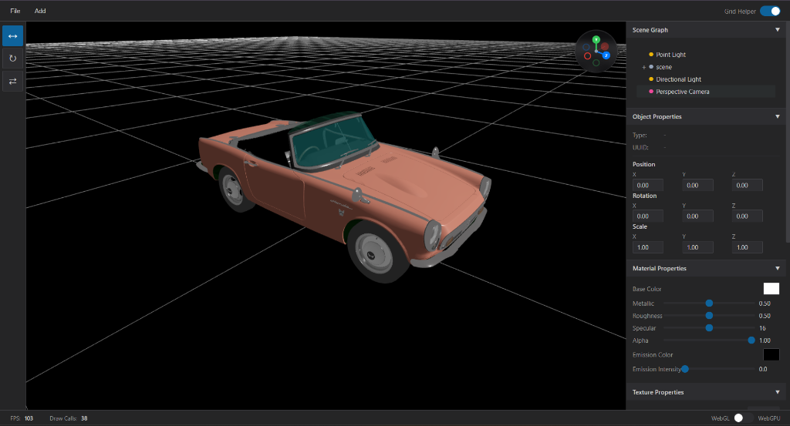

# Vara3D Graphics Engine

[](https://www.typescriptlang.org/)
[](https://developer.mozilla.org/en-US/docs/Web/API/WebGL_API)
[](https://opensource.org/licenses/ISC)

 [Badges] 


### Highlights

- Scene Graph
- Physically Based Rendering (PBR)
- GLTF / GLB Import & Export
- Transform Gizmos
- WebGL Rendering Pipeline
- TypeScript
- WebGPU (In Progress)

## Introduction 

A browser-based 3D Graphics Engine and visual editor built from scratch using TypeScript and raw WebGL, without relying on high-level rendering frameworks.

The project focuses on graphics engine architecture, rendering pipelines, shader programming, scene graph management, physically based rendering (PBR), asset pipelines, and interactive editing tools while providing a deeper understanding of modern real-time rendering.

## Disclaimer

This is a personal graphics programming project developed independently for learning and experimentation. It does not contain proprietary code, assets, or confidential information from any employer.

## Live demo [varatha3deditor.vercel.app](https://varatha3deditor.vercel.app/)

---

## Core Features


- Custom WebGL rendering pipeline
- Physically Based Rendering (PBR)
- GLSL shader system
- Scene Graph architecture
- Parent-child transform hierarchy
- Frustum culling
- GLTF / GLB import & export
- Material and lighting system
- Interactive visual editor
- Transform Gizmos (Translate / Rotate / Scale)
- Interactive SVG View Helper (Camera Orientation & Axis Indicator)
- Real-time rendering statistics (FPS & Draw Calls)

---

## Editor Features  

The integrated editor provides tools for interacting with the rendering engine in real time.



- Scene hierarchy panel
- Property inspector
- Material editor
- Light management
- Transform gizmos
- Interactive SVG View Helper (viewport orientation & axis alignment)
- GLTF / GLB import & export
- Texture & normal map management
- FPS counter
- Draw call statistics

---

## Project structure

```
├── engine/
│   ├── Renderer/    # WebGL context, shader compilation, GLSL shaders
│   ├── MaterialSystem/       # PBR material definitions
│   ├── LightingEngine/       # Light types and management
│   ├── CameraSystem/         # Perspective & orthographic cameras, orbit controls
│   ├── SceneGraph/           # Node hierarchy and transforms
│   ├── AssetImporter/        # GLTF/GLB loader and exporter
│   ├── EventManager/         # Input handling
│   ├── MathLibrary/          # Vec3, Mat4, quaternions — the usual
│   ├── GeometryPrimitives/   # Box, sphere, plane, etc.
│   └── UserInterface/        # Editor panels and controls
├── Showcase/
│   └── 3DEditor/             # The editor app
└── dist/                     # Build output
```

---

## Tech used

- **TypeScript** (strict mode)
- **WebGL** — direct API calls, no abstractions
- **GLSL** for shaders
- **WebGPU** (In Progress)
- **Webpack 5** for bundling
- **Vercel** for hosting the demo

---

## Getting started

## Requirements

- Node.js v16+
- npm

## Installation
```bash
git clone https://github.com/Varatharajan1808/Vara3D-Graphics-Engine.git

cd Vara3D-Graphics-Engine

npm install

npm run dev
```

Open

```text
http://localhost:8081
```

Build production version

```bash
npm run build
```

---

## Quick example

If you want to use the engine programmatically instead of the editor:

```typescript
import { WebGLRenderEngine } from './engine/Renderer/Webgl/WebGLRenderEngine';
import { SceneHierarchyManager } from './engine/SceneGraph/SceneHierarchyManager';
import { CameraController } from './engine/CameraSystem/CameraController';
import { RenderableMeshObject } from './engine/MeshRenderer/RenderableMeshObject';

const canvas = document.getElementById('Mycanvas') as HTMLCanvasElement;
const webgl = new WebGLRenderEngine(canvas);
const scene = new SceneHierarchyManager();

const camera = new CameraController();
camera.PerspectiveCamera(45, canvas.width / canvas.height, 0.1, 1000);
camera.OrbitCamera();

const box = new RenderableMeshObject(new BoxGeometryBuilder().CubeData());
scene.add(box);

const animate = () => {
  webgl.render(scene, camera);
  requestAnimationFrame(animate);
};
animate();
```

---

## RoadMap

- WebGPU backend
- Shadow Mapping
- Skeletal Animation
- Post Processing
- Physics Integration
- Advanced Material Models
- Compute Shader Support

---

## Contact

If you have questions, suggestions, or feedback, feel free to open an issue or start a discussion on GitHub.

GitHub:
https://github.com/Varatharajan1808

---

Built with ❤️ by **Varatharajan**

**TypeScript • WebGL • Graphics Programming • Rendering Engine Development**